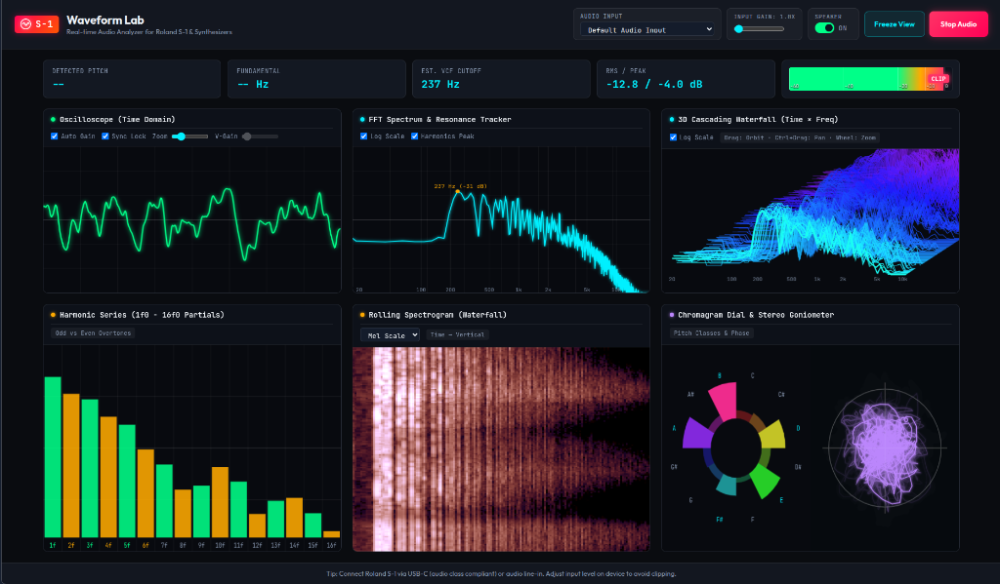

# Waveform Lab 🎛️⚡

> **Real-Time Web Audio DSP Analyzer & Multi-Controller MIDI Telemetry Dashboard**

[](https://github.com/carrommad/waveform-lab/actions/workflows/deploy-pages.yml)
[](https://carrommad.github.io/waveform-lab/)

Waveform Lab is a low-latency audio analysis and hardware telemetry workbench built for analog/virtual-analog synthesizers (such as the **Roland S-1 Tweak Synth**) and expressive multi-controller performance rigs (**Akai MPK Mini**, **Akai APC40 mkII**, and **Apple Magic Trackpad 2**).

* 🌐 **Live Web App (GitHub Pages):** [https://carrommad.github.io/waveform-lab/](https://carrommad.github.io/waveform-lab/)
* 🚀 **Local / VPN Server:** `./run.sh` (runs `server.py` on port `8080`)

<p align="center">
  <a href="https://carrommad.github.io/waveform-lab/">
    
  </a>
</p>

---

## Key Features

### 1. Web Audio DSP Analysis Suite (Client-Side, Zero Latency)
* **Oscilloscope (Time Domain):** Robust zero-crossing trigger sync (*Sync Lock*), Schmitt trigger hysteresis, auto-gain with noise threshold, and optional Tilt Fix droop compensation.
* **FFT Spectrum & Resonance Tracker:** Logarithmic scale (20 Hz to Nyquist), automatic VCF cutoff / harmonic peak detection with electrical line hum rejection.
* **3D Cascading Waterfall (Time × Frequency):** 3D isometric projection with 180 persistence lines, log-frequency scaling, and interactive mouse controls (Orbit, Pan, Zoom).
* **Harmonic Partials Series (1f₀ – 16f₀):** Real-time breakdown of odd vs. even harmonic overtones with fundamental memory and smooth decay.
* **Rolling Spectrogram Heatmap:** Continuous vertical waterfall spectrogram with dynamic AGC auto-scaling.
* **Chromagram Note Dial & Goniometer:** 12-semitone pitch class energy dial and stereo phase scope.
* **Broadcast Level Meter & Clip Alert:** Full-width calibrated peak/RMS dBFS meter with persistent digital clipping alert.
* **Pi Freq Kill:** Multi-stage notch filter bank targeting Raspberry Pi USB and audio jack electrical whine.

### 2. Multi-Device MIDI Telemetry (Host / VPN Mode)
When served from the synthesizer host (e.g. Raspberry Pi 3 via Tailscale VPN or local network), Waveform Lab automatically streams categorized live events and active states across 3 dedicated columns:
* **🎹 Akai MPK Mini:** Active melodic set, voice program, drum kit, looper status, BPM, and modifier state.
* **🎛️ Akai APC40 mkII:** Active performance mode (Melodic, Drums, FX), active drum kit, and metronome/BPM.
* **🖱️ Apple Magic Trackpad 2:** Active MPE mode (LinnStrument, Theremin, Kaoss, Vector), active preset, and master volume.

*(When viewed statically on GitHub Pages without a backend host, the telemetry section hides gracefully while preserving all audio DSP tools).*

---

## Quick Start

### Standalone (GitHub Pages)
Visit [https://carrommad.github.io/waveform-lab/](https://carrommad.github.io/waveform-lab/) in Chrome, Edge, or Firefox. Select your audio input device (or USB-C Audio from the Roland S-1) and click **Start Audio**.

### With Live MIDI Telemetry (Local or Raspberry Pi)
Clone the repository and run:
```bash
./run.sh
```
This launches `server.py` on port `8080`. Open:
```text
http://localhost:8080
```
or over Tailscale VPN:
```text
http://<your-pi-vpn-ip>:8080
```

---

## Tech Stack
* **Frontend:** Vanilla HTML5, Canvas 2D, Web Audio API, Server-Sent Events (SSE).
* **Backend (`server.py`):** Pure Python standard library (`http.server`, `threading`, `subprocess`), zero external dependencies.
* **Deployment:** Automated GitHub Actions workflow deploying to GitHub Pages.

---

## License
MIT

